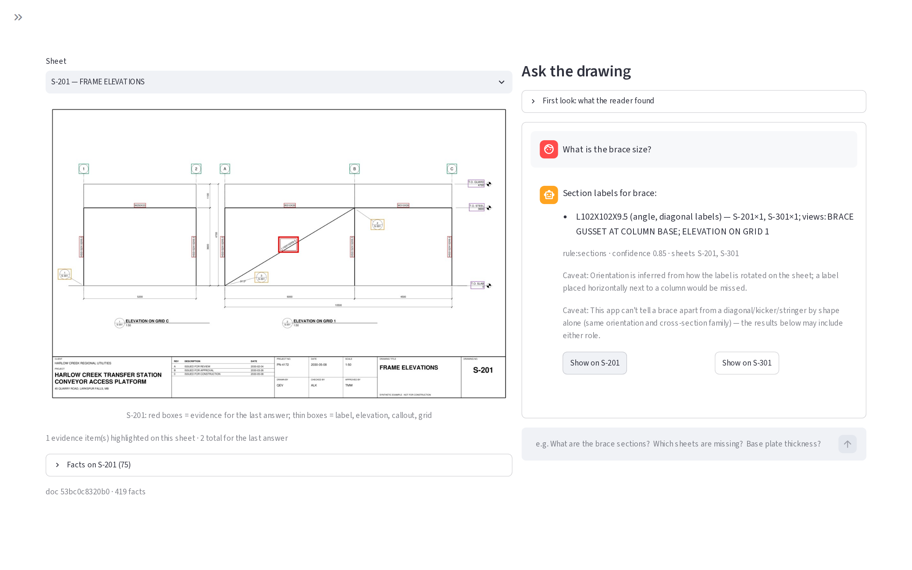
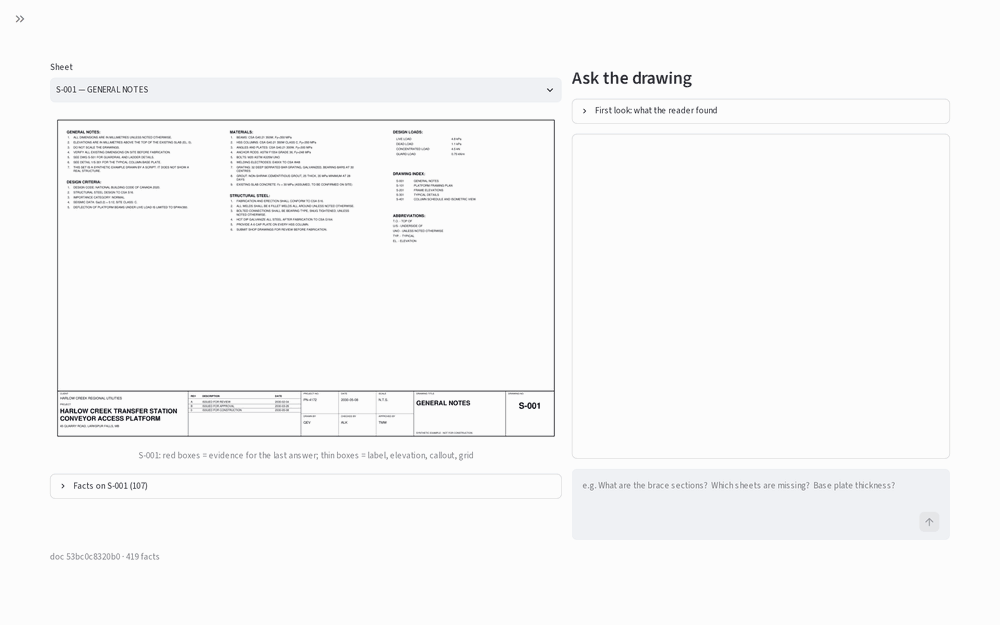

# structural-drawing-reader

Reads structural drawing PDFs into a typed index of facts and answers questions about them, with
the evidence highlighted on the sheet.

- **Every fact is cited.** A member label, dimension, grid bubble, note, revision or title-block
  field is stored with its sheet, its box on the page, the text it was read from and a confidence.
- **Rules first.** Deterministic parsers read the drawing, and deterministic rule answerers answer
  the question. The same PDF and question always give the same answer.
- **Answers point at the drawing.** An answer cites fact ids, and those boxes are drawn on the sheet.
- **A language model is optional, and fenced in.** It is asked only when no rule is confident. It
  may cite only fact ids that exist, and a number it states that is not in a cited fact is flagged.
  Providers: a local OpenAI-compatible server (llama.cpp, Ollama), Gemini, OpenAI, Anthropic, or none.
- **Vector and scanned PDFs.** CAD exports are read directly; scans go through an optional OCR path
  that produces the same text runs.



**Demo:** a static site with the synthetic sheets, the first-look summary and every acceptance
question with its rule answer, cited facts and evidence images:
<https://jaymirzaei.github.io/structural-drawing-reader/> (available once GitHub Pages is
enabled for the repository; build it locally with `uv run python scripts/build_site.py`).

More: [architecture](docs/architecture.md), [drafting conventions](docs/conventions.md),
[providers](docs/providers.md), [evaluation](docs/evaluation.md), [changelog](CHANGELOG.md),
[contributing](CONTRIBUTING.md).

## Quickstart (offline, about five minutes)

Needs Python 3.11 or newer and [uv](https://docs.astral.sh/uv/). No API key, and no network after
the install. Everything below runs on the synthetic example set in `examples/`.

```sh
git clone https://github.com/JayMirzaei/structural-drawing-reader
cd structural-drawing-reader
uv sync --extra ocr        # the OCR extra is only needed for the scanned example
```

**1. See what is in the set.**

```sh
uv run drawing-reader summary examples/access_platform_set.pdf
```

```
CONVEYOR ACCESS PLATFORM / HARLOW CREEK TRANSFER STATION — 5 sheet(s), vector PDF (text and geometry extracted directly)
...
Member / plate designations found (38 labels): HSS152X152X9.5, L102X102X9.5, PL10, PL10X100X230, PL25X350X350, ROD20, W200X27, W250X33, W310X39

Materials: Beams: CSA G40.21 Fy=350 MPa; HSS Columns: CSA G40.21 Fy=350 MPa; Angles And Plates: CSA G40.21 Fy=300 MPa; Anchor Rods: ASTM F1554 Fy=248 MPa; Bolts: ASTM A325M

Standards cited: CSA G164, CSA S16, CSA W48

Referenced but not in the set: S-501
...
```

`--markdown` prints the same summary as Markdown, as the app shows it.

**2. Ask a question and get the evidence image.**

```sh
uv run drawing-reader ask examples/access_platform_set.pdf "What is the brace size?" --evidence out/brace.png
```

```
Section labels for brace:
- L102X102X9.5 (angle, diagonal labels) — S-201×1, S-301×1; views: BRACE GUSSET AT COLUMN BASE; ELEVATION ON GRID 1

[rule:sections, confidence 0.85]
Caveat: Orientation is inferred from how the label is rotated on the sheet; a label placed horizontally next to a column would be missed.
...
Evidence:
- [S-201.label.009] label @ S-201: L102X102X9.5  (page 3, box (616, 358, 658, 387))
- [S-301.label.007] label @ S-301: L102X102X9.5  (page 4, box (1100, 264, 1141, 294))
Evidence image: out/brace_S-201.png
Evidence image: out/brace_S-301.png
```

The evidence is on two sheets, so two images are written, one per sheet. `--json` prints the
answer and the full cited facts instead; `drawing-reader index <pdf>` prints the whole fact index.

**3. Score the acceptance questions.**

```sh
uv run drawing-reader eval --quiet
uv run drawing-reader eval eval/questions_scan.yaml --quiet
```

The first ends with `43/43 passed; known limits: 11 still failing, 0 now passing`; the second (the
scan, read through OCR) with `5/5 passed; known limits: 3 still failing, 0 now passing`.

**4. Open the app.**

```sh
uv run streamlit run app/streamlit_app.py
```

The vector example is selected in the sidebar: press **Load the example**, read the first look, ask
a question, and press **Show on ...** to see the evidence on each sheet. Your own PDF can be uploaded
in the same sidebar; it stays on your machine unless you pick a hosted provider. A file that cannot
be read (damaged, password-protected, empty) gets a message saying why.

**5. Run the tests.**

```sh
uv run pytest -n auto
```



More screenshots: [first look](docs/screenshots/first-look.png),
[the scanned sheet read through OCR](docs/screenshots/scan.png),
[evidence on the detail sheet](docs/screenshots/ask-evidence-detail.png).
They are taken from the running app by `scripts/screenshots.py`.

## Providers

Without a provider the reader answers from its rules alone. To let a model handle what the rules
are unsure about, install its extra, set its key, and pass `--provider` (or pick it in the app's
sidebar, or set `DRAWING_READER_PROVIDER`, which the CLI uses by default and the app's sidebar
starts on). The app also reads a `.env` file in the repository root; the CLI reads the environment
only. See [.env.example](.env.example) and [docs/providers.md](docs/providers.md). Text from a
drawing is passed to a model as fenced, untrusted data, and the app shows it with Markdown escaped.

| Provider | `--provider` | Install | Key or setting | Default model | Tested with |
|---|---|---|---|---|---|
| Rules only | `none` (default) | | | | the real pipeline |
| Local server (llama.cpp, Ollama) | `local` | nothing extra | `DRAWING_READER_LOCAL_URL` (default `http://127.0.0.1:8080`; Ollama listens on `:11434`) | the server's model | a fake server only |
| Google Gemini | `gemini` | `uv sync --extra gemini` | `GEMINI_API_KEY` | `gemini-3.8-flash` | a recording client only |
| OpenAI | `openai` | `uv sync --extra openai` | `OPENAI_API_KEY` | `gpt-5.4-mini` | mocked HTTP only |
| Anthropic | `anthropic` | `uv sync --extra anthropic` | `ANTHROPIC_API_KEY` | `claude-opus-5-5` | mocked HTTP only |

```sh
uv sync --extra ocr --extra anthropic
export ANTHROPIC_API_KEY=...
uv run drawing-reader ask examples/access_platform_set.pdf "What bolts are used?" --provider anthropic
```

**Not verified locally:** none of the four providers has been run against a live API or server for
this release; no key or model server was available. Their requests are tested through the real SDKs
with mocked transports, which pins what is sent and how failures are handled, but not that each
service accepts it. Check the default model ids (override with `DRAWING_READER_<NAME>_MODEL`).

## Docker

```sh
docker compose up                          # the app on http://localhost:8501
OCR=1 docker compose up --build            # with the OCR path for scanned PDFs
docker compose --profile local-model up    # plus an Ollama server for the "Local model" provider
docker build -t drawing-reader . && docker run --rm drawing-reader drawing-reader eval
```

Keys come from `.env` (copy `.env.example`). With the `local-model` profile, pull a model once with
`docker compose exec ollama ollama pull <model>`. The app has no login: anyone who can reach its
port can use it, and any key set in `.env`. Compose therefore publishes the port on `127.0.0.1`
only; keep it that way unless the network is trusted.

**Not verified locally:** Docker is not installed on the machine this was written on. The image is
built and smoke-tested by CI (`.github/workflows/ci.yml`); the Ollama profile is not exercised there.

## Evaluation

62 acceptance questions on the synthetic set, rules only ([details](docs/evaluation.md)):

| Set | Questions | Pass | Known limits (failing today) |
|---|---|---|---|
| Vector, 5 sheets | 54 | 43 | 11 |
| Scan, 1 sheet (OCR) | 8 | 5 | 3 |

A question passes only when the answer holds every expected value, none of the rejected ones (a
grade question must not also list the galvanizing standard), cites the right sheet and, where the
question says so, comes from the rule meant to answer it rather than the keyword fallback.

Known limits stay in the question files with the reason; they are still asked, and reported as
fixed when they start passing. In short:

- Member roles come from label orientation, so plan beams labelled up the sheet are listed as
  columns, and schedule cells and detail labels can be taken for beams.
- Dimensions are not tied to the grid lines they run between ("bay width between A and B"), and an
  overall dimension has no name to match ("overall length of the platform").
- Schedule rows are recognised as a table but not read as records, so "which column mark is at B-1"
  cannot be answered.
- A plate size or thickness held only in a label (`PL25X350X350`) is not found by the size and
  thickness questions.
- The grout rule needs "mm" after the number, and a diameter written before the component name
  ("Ø20 THREADED ROD ANCHORS") is not read; the keyword fallback finds both lines, but that does not
  count as a pass.
- Some wordings reach no rule ("What bolts are used?", "What details are called out on S-101?").
- On scans, OCR runs words together ("PLANNOTES"), and circles (grid bubbles) are not recovered.

This is a score on one small, clean, invented set, not a general accuracy figure.

## Layout

```
src/drawing_reader/
  ingest/        PDF pages -> text runs, segments, circles, page images; the cache
  ocr/           optional OCR path for scanned sheets (extra: ocr)
  parse/         rule parsers: vocabulary and helpers by topic, and parse/sheet/ with one rule
                 group per module (title block, revisions, members, symbols, notes, dimensions)
  schema.py      Fact, SheetMeta and Index (pydantic)
  qa/            router, rule answerers by topic (qa/rules/), first-look summary, evidence rendering
  providers/     the provider contract (base.py), gemini, openai, anthropic, local, registry
  evaluation.py  acceptance-question scorer
  regression.py  snapshot regression for folders of drawings that cannot be committed
  cli.py         drawing-reader index | summary | ask | eval
app/             the Streamlit app
examples/        the synthetic drawing sets, and the script and drafting kit that draw them
eval/            acceptance questions; OCR fidelity and snapshot scripts
scripts/         build_site.py (the static demo), screenshots.py (headless-browser screenshots)
tests/           pytest, 768 tests (7 need the ocr extra and skip without it)
docs/            architecture, conventions, providers, evaluation, screenshots
```

## Design decisions in brief

- **Facts before answers.** Reading the drawing and answering the question are separate steps with
  a typed, inspectable index between them. An answer can only be as good as the facts, and the
  facts can be checked on their own.
- **Rules first, model second.** Most questions about a drawing set are lookups. Rules answer them
  at once, for free, offline and reproducibly; a model is the fallback, not the engine.
- **Evidence is mandatory.** Every fact keeps its box and source text, and every answer cites fact
  ids. A model's answer is held to the same standard: invented ids are dropped, and uncited answers
  and unsupported numbers are capped and flagged.
- **One fact per piece of text.** Each rule marks the runs it consumed, so the same text is not read
  as both a dimension and a note. What no rule claims stays searchable as text.
- **Conventions are written down.** Each parser states the drafting convention it relies on
  ([conventions.md](docs/conventions.md)), so its blind spots can be read off the list.
- **Honest confidence.** Answers from scans are capped and carry a caveat; a question that combines
  several asks is capped below the threshold; a weak rule match says so.
- **Drawing text is untrusted.** It is fenced as data in a model's prompt and escaped before it is
  shown as Markdown, so a note on a drawing cannot instruct the model or put a link in the page.
- **Synthetic, reproducible examples.** The example drawings are drawn by a script in the
  repository and are byte-identical on every run.

## Limits and what is not done

- **General accuracy is not measured here.** The public evaluation is the synthetic set above.
  `eval/snapshot_regression.py` keeps a local folder of drawings as a regression net without
  committing it.
- The rules assume North American structural drafting conventions. Architectural, mechanical and
  multi-discipline sets are out of scope (the app says so when it sees one).
- Member roles come from label orientation, not from geometry; members are not traced as lines.
- Schedules are not read as records; grids are labels, not a coordinate system; dimensions are not
  attached to the objects they measure.
- On scans there is no circle recovery, so no grid bubbles or level markers, and OCR quality limits
  everything else.
- The model providers are untested against live services (see above), and no model-assisted score
  is reported.
- Large sets (more than about 40 sheets) are slow to index and use a lot of memory; the app warns.
- Tested locally only on Python 3.11 on Linux; CI runs 3.11, 3.12 and 3.13 on Linux.

## Licences of dependencies

This project is MIT-licensed. It depends on [PyMuPDF](https://pymupdf.readthedocs.io/) for reading
and rendering PDFs, which is AGPL-3.0 (a commercial licence is available from its authors);
distributing software that includes PyMuPDF is subject to those terms. A published Docker image of
this project bundles PyMuPDF, so the image as a whole is distributed under the AGPL-3.0 terms. The optional OCR extra uses
RapidOCR and ONNX Runtime (Apache-2.0 and MIT) and OpenCV (Apache-2.0). The app uses Streamlit
(Apache-2.0).

## Related

[steel-drawing-ontology](https://github.com/JayMirzaei/steel-drawing-ontology) is the later
work that grew out of this reader: an OWL and SHACL vocabulary for steel fabrication drawings, with
a pipeline from drawing to typed objects to a validated, queryable knowledge graph.

## Disclaimer

This is a portfolio and research project, not engineering software. It is provided "as is", without
warranty of any kind, as the MIT licence states. Its answers, extractions and validation results can be
wrong or incomplete. Do not rely on them for design, fabrication, construction, cost or safety
decisions; a qualified engineer must check anything taken from drawings. Whoever uses this code, or
anything built from it, is responsible for that use and its results; the author accepts no liability
for it.

## Licence

MIT. Copyright (c) 2026 Jay Mirzaei.
