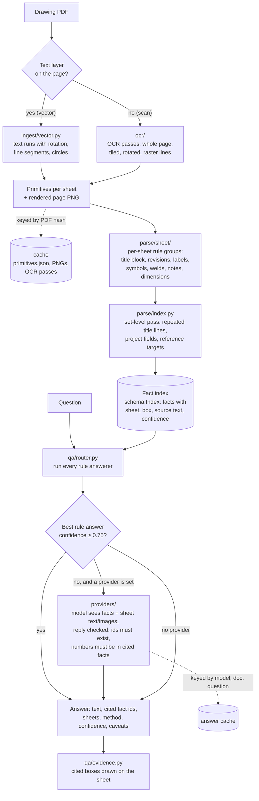

# Architecture

The reader turns a drawing PDF into a list of typed facts, and answers questions from that list.
Every stage before the optional model call is deterministic: the same PDF and the same question
give the same answer, byte for byte.



## Stages

### 1. Ingest (`drawing_reader.ingest`)

`ingest(pdf, cache_dir)` returns a `Document`: one `Sheet` per page, each holding

- **text runs**: a string with its box, font size and writing direction (`TextRun`);
- **segments** and **circles**: the line geometry the symbol and dimension parsers need;
- a **rendered PNG** of the page, used for evidence boxes and for models that can see.

Vector pages are read with PyMuPDF (`vector.py`). A page stored with `/Rotate` is read in its
displayed orientation, so a rotated sheet parses like any other. A file that is not a readable PDF
(damaged, password-protected, empty, no pages) raises `UnreadablePDF` with a reason a user can act
on; the CLI prints it and exits with status 2, and the app shows it as a message.

A page with no usable text layer goes through the OCR path (`drawing_reader.ocr`, optional
extra). It produces the same `TextRun` objects, so the parsers do not know which path a run came
from. Three passes are merged: the whole page, tiles at scan resolution (small dimension text), and
the page rotated a quarter turn (text running up the page). Long straight lines are recovered from
the raster; circles are not.

### 2. Cache (`ingest/cache.py`)

Everything is keyed by a hash of the PDF bytes, so a changed file is a new document and an
unchanged file is never extracted twice. OCR results are stored per page and per pass version,
apart from the primitives file: a change to a parse rule re-runs only the parsers (milliseconds),
never the OCR (seconds to minutes). Cache files are written atomically (temporary file, then
`os.replace`), so two processes ingesting the same PDF never read a half-written file. Page images
are stored relative to the document's cache folder, so a cache filled from one working directory
works from any other. `primitives.json` carries a format version; a file in another format is
ignored and the PDF is read again.

The parsers themselves are not cached. `build_index` runs on every call, which keeps the index
consistent with the code.

### 3. Parse (`drawing_reader.parse`)

`SheetParser` is assembled from one mixin per rule group (`parse/sheet/`), run in a fixed order:
revision tables, title block, sheet scale, project location, member labels, grid bubbles /
callouts / level markers / view titles, weld symbols, load tables, general notes, dimensions, then
everything left over as searchable text. Each rule marks the runs it consumed, so a run becomes at
most one fact. The conventions each group relies on are in [conventions.md](conventions.md). The
state the groups share (consumed runs, the title-block region, whether a revision table was found)
is listed, with the step that writes each item, in `SheetParserBase` (`parse/sheet/base.py`).

Some rule functions are still long, because a rule is a sequence of drafting-convention checks
whose order matters: `parse_dimensions` (dimensions.py), the scan repairs in `scan_repair.py`, the
symbol and revision readers, and `rule_sections` (qa/rules/members.py) run to 150-290 lines.
`parse_titleblock` and `ingest` are split into named steps; splitting the others without changing a
single result is open work.

`build_index` adds what only the whole set can say: lines repeated in most title blocks are the
project and client, not sheet titles; the common title-block fields become project fields; every
sheet reference is checked against the sheets in the set. Scanned sets get extra repairs
(`scan_repair.py`): a misread sheet number is completed from its siblings' numbering scheme, and a
member size that differs by one character from a common one is flagged.

### 4. The fact index (`drawing_reader.schema`)

```python
class Fact(BaseModel):
    id: str  # "S-201.label.009"
    kind: FactKind  # label, dimension, grid, callout, note, revision, ... (15 kinds)
    value: str  # normalised value: "L102X102X9.5", "3600", "1:50"
    unit: str | None
    sheet: str  # sheet number as printed
    page: int
    view: str | None  # the view title the fact sits under, when known
    bbox: tuple[float, float, float, float]  # PDF points on the page
    source_text: str  # the text the fact was read from, unchanged
    confidence: float
    attrs: dict  # kind-specific: orientation, family, target_sheet, fy_mpa ...
```

`Index` holds the facts, one `SheetMeta` per sheet (number, title, scale, fields, image path) and
the project fields. It is plain JSON (`drawing-reader index set.pdf`), so other tools can use it.

### 5. Answer (`drawing_reader.qa`)

The router (`qa/router.py`) runs every rule answerer on the question. Each returns an `Answer`
with text, cited fact ids, a confidence and caveats, or nothing. The most confident answer wins.

- At confidence 0.75 or more it is returned as is.
- Below that, and when a provider is configured, the question goes to the model with the top rule
  hits as hints (see [providers.md](providers.md)). A failed model call never loses the rule answer:
  the failure becomes a caveat.
- An answer between 0.55 and 0.75 with no provider is returned with a "low confidence" caveat.
  Below 0.55 the reader says it found nothing.
- Answers from a scanned set are capped at 0.8 and carry an OCR caveat.
- A question that looks like several questions in one ("... and what ...", two question marks,
  "compare", "versus") is capped below the threshold, since one rule only covers part of it.

Rule answerers are grouped by what they answer from (`qa/rules/`): the set and its sheets,
title-block fields, members, materials, loads, geometry (grids, levels, angles, dimensions),
note text, and a combined rule for a component with several properties. The last resort is a
keyword search over all text facts, at modest confidence.

`first_look(idx)` writes the summary shown when a set is loaded: sheets, member sizes, materials,
standards cited, references to sheets that are not in the set. `scope_advice(idx)` warns when a set is outside what
the rules handle well: a multi-discipline set (only structural questions are answered), a very large
set (slow to index), or a sheet number used twice.

### 6. Evidence (`qa/evidence.py`)

`render_sheet(idx, sheet, kinds, highlight_ids)` draws the cited facts' boxes (red) and optionally
every fact of some kinds (thin, coloured by kind) on the sheet's PNG. The app shows it next to the
answer; `drawing-reader ask --evidence out.png` writes it to a file; the static site embeds it.

## Front ends

| | Entry point | Notes |
|---|---|---|
| App | `app/streamlit_app.py` | upload or load an example; provider picker; chat; evidence overlay; facts table; drawing text shown with Markdown escaped |
| CLI | `drawing-reader index / summary / ask / eval` | same cache; `--provider`; `--json`; `--evidence` |
| Static site | `scripts/build_site.py` | pre-computed answers and evidence images for the examples |
| Library | `from drawing_reader import ingest, build_index, answer` | |

## Test layers

- **Unit tests** on hand-built runs and drawn mini-PDFs (`tests/support.py`, the drafting kit in
  `examples/drafting.py`): one behaviour per test, for each parser and answerer.
- **Example-set tests** on the committed synthetic PDFs, including the scan when OCR is installed.
- **Acceptance questions** (`eval/*.yaml`), scored by `drawing-reader eval`; see
  [evaluation.md](evaluation.md).
- **Provider tests** through the real SDKs with a mocked HTTP transport (OpenAI, Anthropic), a
  recording client (Gemini) and a fake server (local). No test touches the network.
- **Snapshot regression** (`drawing_reader.regression`, `eval/snapshot_regression.py`): for a
  local folder of drawings kept outside the repository, record the index and a fixed set of answers
  once, then report every difference after a change. Snapshots stay outside the repository.
